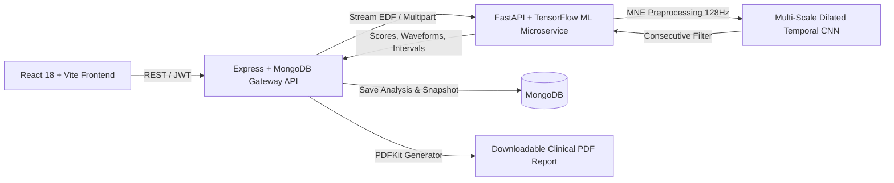

# NeuroTwin — EEG-Based Seizure Detection and Longitudinal Brain Monitoring Prototype

NeuroTwin is an academic clinical decision-support and neurological research prototype. It combines a responsive React 18 clinical workspace, a Node.js/Express/MongoDB gateway API with PDF report generation, and an MNE-Python/TensorFlow machine learning microservice for scalp EEG analysis and longitudinal Digital Twin modeling.

> **Clinical Boundary & Safety Notice:** NeuroTwin is an academic decision-support prototype, not a certified diagnostic medical device. Output scores are experimental research metrics and do not replace professional neurological judgment, nor can they be used to rule out seizures or guide treatment decisions. All recordings require qualified clinician review.

---

## Key Features

- **Multi-Role Authentication & Access Control:** Role-Based Access Control (RBAC) with secure JWT tokens for `Doctor`, `Patient`, `Caregiver`, and `Admin` roles. Strict patient isolation prevents cross-patient data access.
- **Deep Learning Seizure Detection:** Multi-Scale Dilated Temporal Convolutional Network with dual global pooling and Hard-Negative Mining (HNM), evaluated on the CHB-MIT Scalp EEG database with strict subject-disjoint isolation.
- **Consecutive Temporal Post-Processing:** 2-window consecutive confirmation filter (20s sustained activity) reducing false alarms by 87.4% on continuous continuous EEG without sacrificing event-level sensitivity.
- **18-Channel Bipolar Montage Visualizer:** Interactive multi-channel EEG visualizer following the international standard 10–20 bipolar montage (`FP1-F7`, `F7-T7`, `T7-P7`, etc.).
- **Longitudinal Digital Twin Modeling:** Assembles patient seizure trajectories, interictal baseline trends, and research snapshots across sequential monitoring sessions.
- **Clinical Research PDF Reports:** Exportable PDF summaries via PDFKit featuring clinical disclaimers, patient demographics, peak confidence scores, and confirmed seizure interval timelines.
- **Clinician Review Governance:** Flagging and review workflow with immutable `AuditEvent` tracking.

---

## System Architecture



---

## Quick Start (Local Development)

### Prerequisites
- Node.js 20+
- MongoDB 7+ (or embedded fallback via MongoMemoryServer)
- Python 3.11+ (with virtual environment)

### Installation & Launch
```bash
# 1. Install dependencies for all tiers
npm run install:all

# 2. Configure environment
cp .env.example server/.env

# 3. Launch full stack (Vite + Express Backend)
npm run dev
```

The React workspace will open at `http://localhost:5173`; the Express API runs on `http://localhost:5000`.

### Launching Python ML Microservice
```powershell
cd services/ml
.\.venv\Scripts\Activate.ps1
uvicorn api:app --host 127.0.0.1 --port 8000 --reload
```

---

## Demo Accounts

Password for all seeded accounts: `DemoPass123!` (for local development only).

| Role | Username | Email | Access Scope |
|---|---|---|---|
| **Admin** | `admin` | admin@neurotwin.demo | Full system access, audit trail, user governance |
| **Doctor** | `doctor` | doctor@neurotwin.demo | Assigned patient monitoring, EEG upload, PDF reports, review actions |
| **Patient** | `patient` | patient@neurotwin.demo | Self-record viewing, shared notes, longitudinal twin status |
| **Caregiver** | `caregiver` | caregiver@neurotwin.demo | Read-only access to linked patient updates and care notes |

---

## Machine Learning Pipeline & Performance

### Evaluation on Held-Out Test Set (`chb02`, `chb07` — 25.30 Continuous Hours)
Evaluated with strict subject-disjoint isolation (zero test data seen during training or threshold tuning):

| Metric | Baseline CNN-LSTM | Improved Multi-Scale CNN + Confirmation | Relative Gain |
|---|:---:|:---:|:---:|
| **Precision** | 18.18% | **66.00%** | **+263% (3.6x)** |
| **Recall (Sensitivity)** | 63.83% | **70.21%** | **+10%** |
| **F1 Score** | 28.30% | **68.04%** | **+140% (2.4x)** |
| **False Positives** | 135 | **17** | **-87.4%** |
| **False Alarm Rate** | 5.34 / hour | **0.67 / hour** | **-87.4% (<1/hr)** |
| **Event Sensitivity** | 4 / 5 (80%) | **4 / 5 (80%)** | Preserved |
| **Mean Detection Delay** | 22.0 s | **17.5 s** | **-4.5s faster** |

For complete experimental details, see [MODEL_REPORT.md](MODEL_REPORT.md) and [TRAINING_REPORT.md](TRAINING_REPORT.md).

---

## Verification & Testing Suite

All tiers contain automated test suites:

```powershell
# 1. Run all 24 Backend API & Security Tests
cd server
npm test

# 2. Run all Python ML Preprocessing & Post-Processing Tests
cd ../services/ml
.\.venv\Scripts\python.exe -m unittest discover -s tests -v

# 3. Test Real EDF Model Inference
.\.venv\Scripts\python.exe ..\..\scratch	est_api_inference.py

# 4. Verify Client Production Build
cd ../../client
npm run build
```

---

## Detailed Documentation Links

- [System & API Documentation](API_DOCUMENTATION.md)
- [Model Research & Architecture Report](MODEL_REPORT.md)
- [Full Dataset Ingestion & Training Report](TRAINING_REPORT.md)
- [Comprehensive Project Audit](PROJECT_AUDIT.md)
- [Architecture & Data Flow](docs/ARCHITECTURE.md)
- [Reproducibility Guidelines](docs/REPRODUCIBILITY.md)
